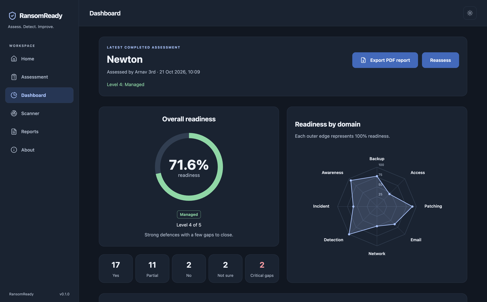
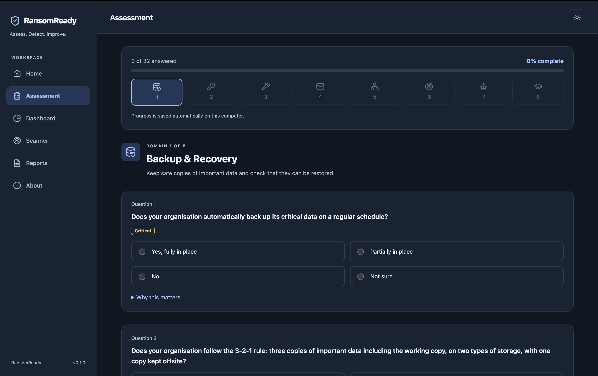
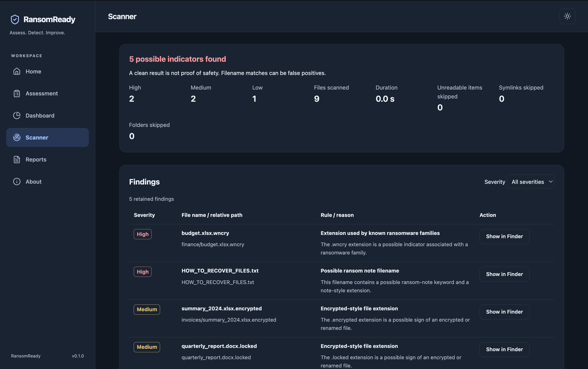
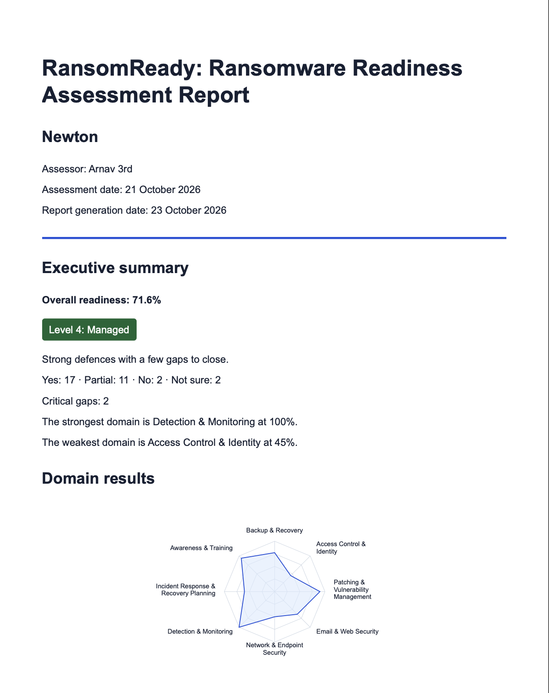

# RansomReady

**Assess. Detect. Improve.**

A local desktop app for assessing an organisation’s ransomware readiness, checking file names for possible warning signs and exporting a PDF report.


## Table of Contents

- [RansomReady](#ransomready)
  - [Table of Contents](#table-of-contents)
  - [Overview](#overview)
  - [Download and install (macOS)](#download-and-install-macos)
    - [Opening an unsigned app](#opening-an-unsigned-app)
    - [Using the app in 4 steps](#using-the-app-in-4-steps)
  - [Why Electron?](#why-electron)
  - [Tech stack](#tech-stack)
  - [Features](#features)
  - [Screenshots](#screenshots)
  - [Architecture](#architecture)
    - [Data flow](#data-flow)
    - [Files in userData](#files-in-userdata)
  - [Security design](#security-design)
  - [Scoring methodology](#scoring-methodology)
  - [Project structure](#project-structure)
  - [How to run](#how-to-run)
  - [How to test](#how-to-test)
  - [Packaging for macOS](#packaging-for-macos)
  - [Limitations and honest notes](#limitations-and-honest-notes)
  - [Author](#author)

## Overview

RansomReady is a college project addressing **NTRO problem statement 317**.
Ransomware can interrupt an organisation’s work and access to important data.
The app helps users review their current practices, identify gaps and prioritise
improvements. A separate read-only scanner checks file names for possible warning
signs; its results do not affect the readiness score.

## Download and install (macOS)

The download location is [GitHub Releases](https://github.com/CodeCatalyst-07/ransomready/releases).
Apple Silicon (**arm64**) is the main release build. If no DMG asset is visible,
use [How to run](#how-to-run) or [Packaging for macOS](#packaging-for-macos).

1. Download the `.dmg` for your Mac from the Releases page.
2. Open the disk image.
3. Drag **RansomReady** to **Applications** using the shortcut.
4. Open **RansomReady** from Applications.

The app was developed and tested on macOS, and only a macOS installer is provided.
The source instructions below may be tried on other systems at your own risk;
those systems have not been verified for this project.

### Opening an unsigned app

The app is **not signed with an Apple Developer certificate or notarized**.
The packaging configuration uses a local ad-hoc signature for Apple Silicon
compatibility; this does not verify the developer’s identity. macOS may show an
“unidentified developer” warning.

For a trusted project build, right-click `/Applications/RansomReady.app`, choose
**Open**, then confirm **Open**. Alternatively, for this trusted copy only, remove
its quarantine attributes and then open the app:

```sh
xattr -cr /Applications/RansomReady.app
```

### Using the app in 4 steps

1. **Assessment:** answer the questions, review and submit; drafts save automatically.
2. **Dashboard:** review the score, domain results and prioritised recommendations.
3. **Scanner (optional):** choose a folder and run a read-only file-name check.
4. **Export PDF:** use Dashboard or Reports, then choose where to save the report.

## Why Electron?

- A native folder dialog selects the scanner’s root; the main process accesses the file system.
- The installed app works offline and keeps assessment and scan data on the computer.
- Native save dialogs choose PDF destinations, and Finder reveals saved reports or findings.
- Electron’s built-in `webContents.printToPDF` creates reports without a PDF library.

These Electron main-process capabilities are not available to a normal browser
page; the browser preview cannot provide this app’s desktop workflow.

## Tech stack

The versions below are the declared dependency ranges in [package.json](package.json).

| Layer | Technology | Used for |
| --- | --- | --- |
| Desktop | Electron `^44.4.5` | App windows, IPC, native dialogs, Finder reveal and PDF printing |
| Renderer | React and React DOM `^19.3.1` | Functional UI components and page rendering |
| Development and build | Vite `^8.3.4`, React plugin `^6.1.2` | Local development, React refresh and renderer builds |
| Interface | Plain JavaScript, CSS, lucide-react `^1.59.0` | App logic, themes, layout and icons |
| Local persistence | Node.js built-in file-system APIs and JSON | Main-process storage and read-only scanning |
| Packaging | electron-builder `^26.15.3` | macOS app and DMG packaging |
| Development scripts | concurrently `^10.0.5`, wait-on `^9.1.0`, cross-env `^10.1.0` | Start Vite and Electron with the required environment |

There is no database, backend server or external API. Vite’s local development
server is used only when running the development workflow.

## Features

- **Assessment:** 32 questions, 8 domains, explanations and answer review.
- **Save and resume:** automatic local draft saving.
- **Scoring:** weighted answers, 5 maturity levels and a critical-gap cap.
- **Recommendations:** prioritised actions for every non-Yes answer.
- **Dashboard:** overall score, SVG radar chart and domain bars.
- **Result details:** answer counts, weakest areas and recommendation filters.
- **Scanner:** native folder selection, progress, cancellation and severity filters.
- **Scan results:** names and metadata only, Show in Finder and the latest saved scan.
- **PDF export:** Dashboard or Reports, with a native save dialog and Finder reveal.
- **Report contents:** all recommendations and an optional latest scan, listing up to 25 findings.
- **Local storage:** answers and scan results in `userData`; only the theme uses localStorage.
- **Error recovery:** a page fallback with Try again and Go to Home actions.
- **Appearance:** light and dark themes with keyboard-accessible controls.

Reports shows the latest assessment summary, optional scan details and PDF export,
with a link to the Dashboard. Only the latest assessment is shown; earlier
assessments remain saved locally but are not shown in the app. Scores are
recalculated from saved answers, never stored.

## Screenshots

The image files below must be added before submission.

| Screen | Preview and caption |
| --- | --- |
| Dashboard | <br>Readiness results and prioritised improvements. |
| Assessment | <br>Answer questions and review saved progress. |
| Scanner | <br>A separate read-only check of a chosen folder. |
| PDF report | <br>A printable summary with recommendations and optional scan results. |

## Architecture

```text
React UI (renderer)
        <-> preload.cjs (contextBridge, 13 named methods)
        <-> IPC (electron/ipc/handlers.cjs)
        <-> Electron main process
              |-- storage.cjs        <-> userData/ JSON files
              |-- scanner/           --> selected folder (read-only)
              |-- report/pdfExport.cjs
                    --> hidden window (JavaScript disabled)
                    --> printToPDF --> native-dialog-selected PDF destination
```

### Data flow

1. Answer questions; the renderer sends drafts and completed answers through preload and IPC.
2. Main-process storage validates and writes JSON.
3. `scoreAssessment` recalculates results from saved answers for Dashboard and Reports.
4. The pure `buildReportHtml` creates a standalone escaped HTML document.
5. The main process asks where to save, then a hidden Electron window prints an A4 PDF.
6. Finder reveals the saved file.

Scan results load independently; an unavailable scan does not prevent the
dashboard or report from working. The storage module accepts its base directory,
so Node tests use isolated temporary folders. Writes are queued and atomic:
write a temporary file, then rename it over the destination. Submission saves a
completed assessment before clearing the draft.

### Files in userData

Files under `app.getPath('userData')`:

- `draft.json`: answers, organisation/assessor, wizard position and timestamps.
- `assessments/assessment-<timestamp>.json`: completed answers and metadata, without scores.
- `latest-scan.json`: the latest scan, replacing the previous scan.

On macOS the usual location is `~/Library/Application Support/RansomReady`.
To see the actual path, run `(await window.api.getAppInfo()).dataPath` in Electron
DevTools. Electron may create its own cache and preference files there too.

## Security design

- Main window: `contextIsolation: true`, `sandbox: true`, `nodeIntegration: false`.
- The renderer has no Node modules or raw IPC access; `window.require` and `window.process` are undefined.
- A CSP in `index.html` restricts resources; it permits inline scripts/styles for Vite development and the local development WebSocket. New windows and page navigation are denied.
- Preload exposes exactly 13 named methods: `getAppInfo`, `saveDraft`, `loadDraft`, `clearDraft`, `saveAssessment`, `getLatestAssessment`, `chooseScanFolder`, `startScan`, `cancelScan`, `revealInFolder`, `getLatestScan`, `onScanProgress`, `exportReportPdf`.
- The renderer never supplies destination file paths or the scanner’s root path. Native dialogs in the main process choose them. Show in Finder accepts only a validated relative finding path inside the scanned root.
- The scanner is read-only: it lists directories and checks metadata, never opens file contents or intentionally follows symlinks, and never changes scanned files. Symbolic links are skipped, with containment checked again before revealing a finding.
- Report strings are HTML-escaped. Report CSP is `default-src 'none'; style-src 'unsafe-inline'; img-src data:`; no scripts or external resources are included.
- The hidden PDF window has JavaScript disabled, isolation/sandbox enabled, Node disabled, no preload, and denies navigation/new windows. Temporary HTML is removed and the window destroyed after success or failure.
- App data never leaves the computer through RansomReady. There are no network uploads, telemetry or external analysis services. PDF exports contain organisation and scan information; users control where they save or share them. Local JSON and PDFs are not encrypted by the app.

## Scoring methodology

Question weights are **3 = critical**, **2 = important**, **1 = good practice**.
Answer values are **Yes = 1**, **Partial = 0.5**, **No = 0**, **Not sure = 0**.
Points = weight × answer value. Overall percent = total points / total possible
points × 100; each domain uses its own points and maximum. Percentages are rounded
once to one decimal place before level lookup. Overall is not an average of
rounded domain percentages.

| Level | Name | Percent |
| --- | --- | --- |
| 1 | Initial | 0–24.9 |
| 2 | Developing | 25–49.9 |
| 3 | Defined | 50–69.9 |
| 4 | Managed | 70–84.9 |
| 5 | Resilient | 85–100 |

A weight-3 question answered No or Not sure is a critical gap. Three or more
critical gaps cap the overall level at Level 2 (Developing), without changing
the percentage. Domain levels are not capped.

Each non-Yes answer creates a recommendation. Priority score is
`weight × (1 - answer value)`, sorted descending, then weight descending, domain
order ascending and question ID ascending. Weight gives the High / Medium / Low
label. The PDF groups recommendations by that label and preserves the engine’s
order within each group. The dashboard supports filters and Show all.

Implementation details: [scoring engine](src/utils/scoring.js),
[maturity levels](src/config/maturityLevels.js),
[answer values](src/config/answerOptions.js) and
[question bank](src/data/questions.json). The PDF’s Methodology and limits
section repeats these rules.

## Project structure

```text
electron/
  main.cjs                 Secure app window and lifecycle
  preload.cjs              Named contextBridge operations
  ipc/handlers.cjs         IPC operations and error responses
  storage.cjs              Local atomic JSON storage
  scanner/                 Read-only scanner and sample indicator rules
  report/pdfExport.cjs     Native save dialog and hidden-window PDF printing
src/
  main.jsx                 React entry point
  App.jsx                  Page navigation and error boundary
  index.css                Global styles and theme variables
  components/              Layout and assessment/dashboard/scanner UI
    ErrorBoundary.jsx      Page rendering error fallback
    ExportStatus.jsx       Shared export status and dismiss action
    Sidebar.jsx            Navigation and runtime app version
  pages/                   Home, Assessment, Dashboard, Scanner, Reports, About
    ReportsPage.jsx        Latest assessment summary and PDF export
  config/                  Navigation, answer options, icons and maturity levels
  data/                    Eight domains and 32 questions
  hooks/
    useAssessment.js       Assessment state and draft save/resume
    useReportExport.js     Shared Dashboard and Reports export flow
    useTheme.js            Theme preference
  utils/
    questionBank.js        Bundled question helpers
    scoring.js             Pure scoring engine
    scoreAssessment.js     Engine wired to bundled questions
    chartMath.js           SVG chart and filtering helpers
    reportHtml.js          Pure standalone report HTML builder
  styles/                  Layout and component styles
scripts/                   Node tests, data validation and harmless scan demo
package.json               Package details, scripts and dependency ranges
package-lock.json          Dependency lockfile
vite.config.js             React build and local development configuration
index.html                 Renderer entry point and CSP
electron-builder.yml       macOS packaging configuration
```

## How to run

Use Node.js **22.12.0 or newer**, npm and Git. This minimum matches the project’s
`engines` field and satisfies the installed Vite engine requirement. Initial
dependency installation requires internet access.

```sh
git clone https://github.com/CodeCatalyst-07/ransomready.git
cd ransomready
npm install
npm run dev
```

Vite uses `http://localhost:5173`; Electron waits for it and opens DevTools.
Keep port 5173 free. React edits refresh automatically; restart the app after
Electron/preload changes. Stop with Ctrl+C to end both processes. A browser
preview has no desktop bridge, assessment storage, scanner or PDF export access.

```sh
npm run build  # Build renderer into dist/
npm start      # Build and open the desktop app using dist/index.html
```

## How to test

The test scripts use Node built-in modules; no additional test or PDF
dependencies are required. Observed results on macOS:

```sh
npm run test:storage    # 10 tests passed: validation, atomic storage and failure handling
npm run test:scoring    # 12 tests passed: percentages, levels, cap and recommendation ordering
npm run test:chartmath  # 16 tests passed: SVG geometry, filtering and weakest-domain helpers
npm run test:scanner    # 19 tests passed: name rules, traversal, limits, cancellation and symlinks
npm run test:report     #  8 tests passed: escaping, CSP, scores, domains and optional scan
npm run check:data      # 245 validation checks passed: question-bank schema and consistency
npm run build          # Production renderer build; not part of the test count
```

**Total: 65 tests and 245 data-validation checks passed (310 in total).**
The validator’s final PASS summary is not counted as an additional check.
These counts describe this checkout’s command output, not native UI coverage.

For a harmless scanner demo, run `npm run demo:scan-folder` and choose the printed
temporary folder in Scanner. The generator recreates its own disposable demo
folder and verifies the counts: 2 High, 2 Medium and 1 Low across 9 files.

<details>
<summary>Manual desktop checks (for developers)</summary>

1. Complete an assessment, checking draft resume, review and submission. All Yes gives 100% / Level 5; all No gives 0% / Level 1.
2. Check Reports with no assessment, then with a completed assessment. Its score, level and critical-gap count should match Dashboard. Check the scan line with and without a saved scan.
3. Export from Dashboard and Reports. Choose a location, open the PDF and inspect its sections, chart and recommendations. Only a report with a saved scan includes the scan section. Cancel the save dialog and confirm no file or success/error message is produced.
4. Confirm export is disabled while busy. Failures show a dismissible error; success shows a dismissible saved-path status that clears after eight seconds.
5. Temporarily throw an error while rendering a page to check the error fallback and navigation. Remove the throw and verify recovery. **Never leave the deliberate throw in submitted code.**
6. Check both themes, visible keyboard focus, Tab/Shift+Tab and Enter/Space. Check the sidebar’s runtime version and inspect the console for unexpected errors or warnings. The deliberate boundary test should log its error.
7. In Electron DevTools, verify `Object.keys(window.api).length === 13`, `window.require === undefined` and `window.process === undefined`.

</details>

## Packaging for macOS

Run on a Mac after `npm install`. Check the author in `package.json` before
submission.

```sh
npm run pack           # Unpacked .app for smoke testing on this Mac
npm run dist:mac:arm64  # Main Apple Silicon DMG build
npm run dist:mac        # Universal DMG target for Intel and Apple Silicon
npm run dist:mac:x64    # Intel DMG target
```

Output is in `release/`; unpacked apps are in architecture-specific subfolders.
The configured DMG filename pattern is `RansomReady-<version>-<arch>.dmg`.
The universal and Intel commands are packaging targets, not claims that those
builds have been tested.

See [Opening an unsigned app](#opening-an-unsigned-app) for first-launch
instructions. Keep DMGs out of the repository and distribute them through
[GitHub Releases](https://github.com/CodeCatalyst-07/ransomready/releases).
Assessment files live in writable `userData`, outside the app bundle and DMG.

## Limitations and honest notes

- This is a self-assessment, not a formal audit, certification or compliance statement. Answers are not independently verified.
- Questions reflect widely recommended good practice; weights, thresholds and maturity labels are project design choices, not an official standard.
- The scanner uses a small sample indicator list and checks file names only. False positives and false negatives are possible. A clean result does not prove a computer is safe; RansomReady is not an antivirus or continuous monitor.
- Scans skip symlinks, `.git` and `node_modules`. Defaults limit scans to 200,000 files, depth 25 and 500 retained findings. Unreadable entries are skipped; cancellation or limits yield partial results. PDFs list up to 25 retained findings, with original scan counts.
- The latest scan may concern a different folder or date from the assessment. It is a separate point-in-time check and never affects readiness scoring.
- Only the latest assessment is displayed. No report library, cloud sync or external analysis is implemented.
- For the unsigned macOS build, see the [first-launch instructions](#opening-an-unsigned-app). Other operating systems have not been verified.

## Author

- GitHub: [CodeCatalyst-07](https://github.com/CodeCatalyst-07).
- Repository: [CodeCatalyst-07/ransomready](https://github.com/CodeCatalyst-07/ransomready).

College project, NTRO problem statement 317: Ransomware Readiness Assessment tool.
